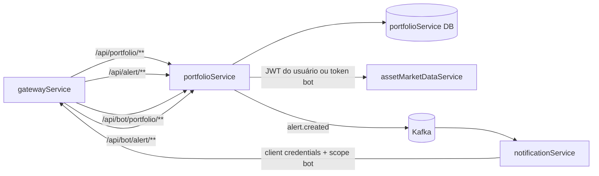
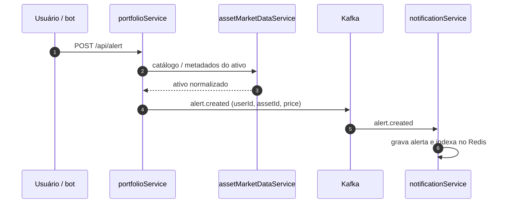

# portfolioService

**Portfólios, posições e alertas do ChainTracker.** O serviço mantém as carteiras de cada usuário, calcula preço médio, valor atual, PnL e resumo da carteira, e publica os alertas de preço que serão monitorados pelo `notificationService`.

---

## Visão geral

O `portfolioService` é o núcleo de domínio financeiro do ecossistema. Ele:

- cria, lista e exclui portfólios por usuário;
- adiciona posições de criptomoedas e de ações, tanto a preço de mercado quanto a preço informado;
- faz upsert por ativo, recalculando o preço médio ponderado em cada compra;
- reduz posições nas vendas, com validação de saldo;
- calcula o valor atual, o PnL por posição e o resumo consolidado da carteira;
- normaliza o ativo informado pelo usuário (id, ticker ou nome da cripto; símbolo da ação);
- publica alertas de preço no tópico Kafka `alert.created`.

O serviço não fala com CoinGecko nem com Alpaca diretamente: todos os dados de mercado vêm do `assetMarketDataService`. Também não envia notificações; isso é responsabilidade do `notificationService`.

---

## Stack

| Item | Tecnologia |
|---|---|
| Linguagem / runtime | Java 21 |
| Framework | Spring Boot 4.1.1 |
| Build | Maven (wrapper `mvnw`) |
| HTTP | Spring Web MVC + `RestClient` |
| Persistência | Spring Data JPA + PostgreSQL |
| Migrações | Flyway (`spring-boot-starter-flyway` + módulo PostgreSQL) |
| Mensageria | Kafka (`spring-boot-starter-kafka`) |
| Redis | `spring-boot-starter-data-redis` + `RedisTemplate` configurado |
| Segurança | Spring Security OAuth2 Resource Server (JWT) |
| Documentação | Springdoc OpenAPI + Swagger UI |
| Observabilidade | Actuator + Micrometer Prometheus |
| Produtividade | Lombok |
| Testes | JUnit, Spring Boot Test, Spring Security Test |

---

## Posição no ecossistema



- O **gatewayService** encaminha as rotas autenticadas e as rotas do bot.
- O **assetMarketDataService** fornece catálogo, metadados e cotações atuais.
- O **notificationService** consome `alert.created`, grava o alerta e o monitora contra os eventos de mercado.

---

## Como funciona

### 1. Portfólios

Cada portfólio pertence a um usuário identificado pelo `sub` do JWT.

- **Criação**: grava `name` e `ownerId`; o ID é um UUID gerado pelo Hibernate.
- **Listagem**: retorna apenas os portfólios cujo `owner_id` é o usuário autenticado.
- **Exclusão**: busca o portfólio por `id` e `ownerId`, apaga todas as posições e depois o portfólio, na mesma transação.
- **Acesso**: `findByIdAndOwner` responde `404` quando o portfólio não existe ou pertence a outro usuário. O mesmo `404` é usado nos dois casos.

### 2. Resolução do ativo

Antes de gravar uma posição de cripto, o serviço normaliza o texto informado para o **id da CoinGecko**:

1. procura uma moeda cujo `id` seja igual ao texto (ignorando maiúsculas/minúsculas);
2. se não encontrar, procura pelo `symbol`;
3. se não encontrar, procura pelo `name`;
4. se nada corresponder, mantém o texto original e deixa o fluxo normal reportar o erro.

Assim, `bitcoin`, `BTC` e `Bitcoin` chegam ao mesmo `asset_id`.

Para ações, o símbolo canônico vem do catálogo do `assetMarketDataService`. O serviço usa esse símbolo tanto na busca quanto na gravação, o que faz `aapl` e `AAPL` caírem na mesma posição.

### 3. Criação de posições

Existem quatro rotas de compra:

| Rota | Preço usado |
|---|---|
| `/cripto/market` | cotação atual da cripto |
| `/cripto` | preço informado no corpo |
| `/stock/market` | cotação atual da ação |
| `/stock` | preço informado no corpo |

Fluxo comum:

1. valida a existência e o dono do portfólio;
2. resolve o ativo;
3. busca os metadados e a cotação atual no `assetMarketDataService`;
4. procura uma posição existente pelo par `(portfolio_id, asset_id)`;
5. se existir, aplica `buyAsset(quantidade, preço)` e atualiza nome, símbolo, exchange e tipo;
6. se não existir, cria a posição com `averagePrice` igual ao preço da compra;
7. devolve o `PositionResponseDto` já com valor atual e PnL calculados sobre a cotação de mercado.

#### Preço médio ponderado

`Position.buyAsset` calcula:

```text
novoPrecoMedio = (quantidadeAtual * precoMedioAtual + quantidadeComprada * precoCompra)
                 / (quantidadeAtual + quantidadeComprada)
```

O resultado é arredondado para 12 casas com `HALF_UP`. O preço informado é usado no cálculo do custo; o valor atual e o PnL continuam sendo calculados com a cotação de mercado retornada pelo serviço de ativos.

### 4. Venda e remoção

`sellAsset(quantidade)`:

- rejeita quantidade menor ou igual a zero com `409 Conflict`;
- rejeita quantidade maior que a posição com `409 Conflict` e a mensagem de saldo insuficiente;
- subtrai a quantidade vendida;
- quando a quantidade chega a zero, zera o `averagePrice`.

A rota web de venda é `POST /api/portfolio/{id}/positions/delete` e recebe `assetId`, `quantity` e `type`. A rota do bot é `POST /api/bot/portfolio/{id}/positions/sell` e usa `SellPositionRequestDto`, que também aceita um campo `price`.

O modelo atual **não calcula PnL realizado**: o `price` da venda do bot é aceito no contrato, mas a venda apenas reduz a quantidade. O preço médio é zerado quando a posição é vendida por completo.

### 5. Consulta de posições

`GET /api/portfolio/{id}/positions` (e a equivalente do bot) percorre as posições do portfólio e, para cada uma:

- cripto: busca a cotação pelo `asset_id`;
- ação: busca a cotação pelo `symbol` já gravado na posição.

Se o `assetMarketDataService` não devolver o dado de mercado, a resposta é `404`. O `PositionMapper` monta o `PositionResponseDto` com quantidade, preço médio, valor atual, PnL em valor e PnL percentual.

### 6. Resumo da carteira

`GET /api/portfolio/{id}/resume` soma as posições e devolve:

| Campo | Cálculo |
|---|---|
| `portfolioValue` | soma de `precoAtual * quantidade` |
| `portfolioPnlValue` | `portfolioValue - custoTotal` |
| `portfolioPnlPercentage` | `portfolioPnlValue / custoTotal * 100`; `null` se o custo total for zero |
| `bestPerformer` | posição com maior PnL percentual, no formato `Nome (SYMBOL)` |
| `worstPerformer` | posição com menor PnL percentual, no mesmo formato |

Regras do ranking:

- posições com PnL `null` (preço desconhecido) ficam fora;
- posições com quantidade zero (vendidas por completo) também ficam fora;
- o ranking usa **percentual**, não valor absoluto, para não favorecer sempre a maior posição.

O cálculo usa os valores crus das posições; o arredondamento para duas casas acontece apenas na montagem do DTO de resposta.

### 7. Alertas de preço

`POST /api/alert` (autenticado) e `POST /api/bot/alert?userId=` (bot) recebem `assetId`, `price` e `type`.

1. **Cripto**: resolve o id, consulta os metadados no catálogo e usa o `assetId` retornado; se não encontrar, responde `404`.
2. **Ação**: converte o símbolo para maiúsculas, consulta o catálogo e usa o símbolo canônico; se não encontrar, responde `404`.
3. Monta `AlertKafkaDto(userId, assetId, price)` e publica no tópico `alert.created`, usando o `userId` como chave.

O alerta em si é persistido e monitorado pelo `notificationService`, que consome esse tópico.



### 8. Integração com o serviço de mercado

O `AssetMarketDataClient` usa `RestClient` com base URL `http://assetmarketdata-service:8082/api` e dois mecanismos:

- **`JwtForwardingInterceptor`**: copia o Bearer token do `SecurityContextHolder` para a chamada de saída. Isso atende tanto o usuário autenticado quanto o token de serviço com escopo `bot` usado pelo fluxo do Telegram.
- **Detecção de rota do bot**: quando a requisição recebida começa com `/api/bot/`, as chamadas de saída usam as cópias `/bot/**` do serviço de ativos; caso contrário, usam as rotas internas ou autenticadas.

| Operação | Rota autenticada | Rota do bot |
|---|---|---|
| catálogo de cripto | `/currency` | `/bot/currency` |
| metadados de cripto | `/internal/data/currency/{assetId}` | `/bot/currency/{assetId}/data` |
| metadados de ação | `/internal/data/stock/{symbol}` | `/bot/stock/{symbol}/data` |
| cotação de cripto | `/currency/{assetId}` | `/bot/currency/{assetId}` |
| cotação de ação | `/stock/{symbol}` | `/bot/stock/{symbol}` |

---

## API HTTP

A porta interna do serviço é **8087**. No stack completo, ele é exposto na porta **3004** do host e acessado preferencialmente pelo gateway em `http://localhost:3006`.

### Rotas autenticadas

| Método | Caminho | Corpo | Resposta |
|---|---|---|---|
| `POST` | `/api/portfolio` | `{ "name": "..." }` | `201` + portfólio criado |
| `GET` | `/api/portfolio` | — | `200` + lista de portfólios do usuário |
| `DELETE` | `/api/portfolio/{id}` | — | `204` |
| `GET` | `/api/portfolio/{id}/resume` | — | `200` + resumo |
| `GET` | `/api/portfolio/{id}/positions` | — | `200` + posições |
| `POST` | `/api/portfolio/{id}/positions/cripto/market` | `{ "assetId": "...", "quantity": ... }` | `200` + posição |
| `POST` | `/api/portfolio/{id}/positions/cripto` | `{ "assetId": "...", "quantity": ..., "price": ... }` | `200` + posição |
| `POST` | `/api/portfolio/{id}/positions/stock/market` | `{ "assetId": "...", "quantity": ... }` | `200` + posição |
| `POST` | `/api/portfolio/{id}/positions/stock` | `{ "assetId": "...", "quantity": ..., "price": ... }` | `200` + posição |
| `POST` | `/api/portfolio/{id}/positions/delete` | `{ "assetId": "...", "quantity": ..., "type": "CRIPTO|STOCK" }` | `200` |
| `POST` | `/api/alert` | `{ "assetId": "...", "price": ..., "type": "CRIPTO|STOCK" }` | `200` |
| `GET` | `/api/portfolio/bot?userId=...` | — | `200` + lista por `userId` |

> A rota `/api/portfolio/bot` é uma listagem alternativa por `userId`. As rotas operacionais do bot ficam sob `/api/bot/**`.

### Rotas do bot

Exigem token com `SCOPE_bot` e recebem o `userId` como query parameter, porque o fluxo do Telegram não carrega o JWT do usuário final.

| Método | Caminho | Corpo | Resposta |
|---|---|---|---|
| `GET` | `/api/bot/portfolio?userId=` | — | `200` + lista |
| `POST` | `/api/bot/portfolio?userId=` | `{ "name": "..." }` | `201` + portfólio |
| `DELETE` | `/api/bot/portfolio/{id}?userId=` | — | `204` |
| `GET` | `/api/bot/portfolio/{id}/positions?userId=` | — | `200` + posições |
| `GET` | `/api/bot/portfolio/{id}/resume?userId=` | — | `200` + resumo |
| `POST` | `/api/bot/portfolio/{id}/positions/cripto/market?userId=` | `{ "assetId": "...", "quantity": ... }` | `200` + posição |
| `POST` | `/api/bot/portfolio/{id}/positions/cripto?userId=` | `{ "assetId": "...", "quantity": ..., "price": ... }` | `200` + posição |
| `POST` | `/api/bot/portfolio/{id}/positions/stock/market?userId=` | `{ "assetId": "...", "quantity": ... }` | `200` + posição |
| `POST` | `/api/bot/portfolio/{id}/positions/stock?userId=` | `{ "assetId": "...", "quantity": ..., "price": ... }` | `200` + posição |
| `POST` | `/api/bot/portfolio/{id}/positions/sell?userId=` | `{ "type": "CRIPTO|STOCK", "assetId": "...", "quantity": ..., "price": ... }` | `204` |
| `POST` | `/api/bot/alert?userId=` | `{ "assetId": "...", "price": ..., "type": "CRIPTO|STOCK" }` | `204` |

### Exemplos

#### Criar portfólio

```bash
curl -X POST http://localhost:3006/api/portfolio \
  -H "Authorization: Bearer <access_token>" \
  -H "Content-Type: application/json" \
  -d '{"name":"Minha carteira"}'
```

```json
{
  "id": "0f6c2d4e-8a3b-4c5d-9e7f-123456789abc",
  "name": "Minha carteira"
}
```

#### Adicionar cripto a preço de mercado

```bash
curl -X POST http://localhost:3006/api/portfolio/<portfolioId>/positions/cripto/market \
  -H "Authorization: Bearer <access_token>" \
  -H "Content-Type: application/json" \
  -d '{"assetId":"BTC","quantity":0.25}'
```

O `assetId` pode ser `bitcoin`, `BTC` ou `Bitcoin`; a posição é gravada com o id `bitcoin`.

#### Adicionar ação a preço informado

```bash
curl -X POST http://localhost:3006/api/portfolio/<portfolioId>/positions/stock \
  -H "Authorization: Bearer <access_token>" \
  -H "Content-Type: application/json" \
  -d '{"assetId":"AAPL","quantity":10,"price":180.00}'
```

#### Listar posições

```bash
curl http://localhost:3006/api/portfolio/<portfolioId>/positions \
  -H "Authorization: Bearer <access_token>"
```

```json
[
  {
    "assetId": "bitcoin",
    "symbol": "btc",
    "name": "Bitcoin",
    "quantity": 0.25,
    "averagePrice": 60000.00,
    "positionValue": 16858.04,
    "pnlAmount": 1858.04,
    "pnlPercentage": 12.39
  }
]
```

#### Resumo da carteira

```bash
curl http://localhost:3006/api/portfolio/<portfolioId>/resume \
  -H "Authorization: Bearer <access_token>"
```

```json
{
  "bestPerformer": "Bitcoin (btc)",
  "worstPerformer": "Apple Inc. (AAPL)",
  "portfolioPnlValue": 1234.56,
  "portfolioPnlPercentage": 4.21,
  "portfolioValue": 30567.89
}
```

#### Vender parte da posição

```bash
curl -X POST http://localhost:3006/api/portfolio/<portfolioId>/positions/delete \
  -H "Authorization: Bearer <access_token>" \
  -H "Content-Type: application/json" \
  -d '{"assetId":"bitcoin","quantity":0.1,"type":"CRIPTO"}'
```

#### Criar alerta

```bash
curl -X POST http://localhost:3006/api/alert \
  -H "Authorization: Bearer <access_token>" \
  -H "Content-Type: application/json" \
  -d '{"assetId":"BTC","price":120000,"type":"CRIPTO"}'
```

---

## Modelo de dados

### Tabela `portfolio`

| Coluna | Tipo | Observação |
|---|---|---|
| `id` | `varchar(255)` | chave primária; UUID gerado na aplicação |
| `name` | `varchar(255)` | nome do portfólio |
| `owner_id` | `varchar(255)` | `sub` do usuário no Keycloak |

### Tabela `position`

| Coluna | Tipo | Observação |
|---|---|---|
| `id` | `bigint identity` | chave primária |
| `portfolio_id` | `varchar(255)` | FK para `portfolio(id)` |
| `asset_id` | `varchar(255)` | id da CoinGecko ou símbolo da ação |
| `name` | `varchar(255)` | nome do ativo no momento da compra |
| `symbol` | `varchar(255)` | ticker do ativo |
| `exchange` | `varchar(255)` | bolsa, para ações |
| `quantity` | `numeric(38,18)` | quantidade em carteira |
| `average_price` | `numeric(38,18)` | preço médio ponderado |
| `type` | `varchar(255)` | `CRIPTO` ou `STOCK` |

Restrições:

- `position_type_check` limita `type` a `CRIPTO` ou `STOCK`;
- `fk_position_portfolio` liga a posição ao portfólio;
- `uk_position_portfolio_asset` garante uma única linha por `(portfolio_id, asset_id)`.

### Migrações

| Versão | Conteúdo |
|---|---|
| `V1` | cria `portfolio` e `position`, com a constraint de unicidade e a FK |
| `V2` | migra `asset_id` legado de numérico para `varchar` e remove a tabela `asset` |
| `V3` | cria o índice `idx_portfolio_owner_id` |
| `V4` | adiciona `exchange` |
| `V5` | adiciona `name` |
| `V6` | adiciona `symbol` |
| `V7` | adiciona `type` |
| `V8` | alinha o schema da posição e o tamanho de `symbol` |
| `V9` | alinha o tamanho de `type` |

O Flyway roda com `baseline-on-migrate: true` e `baseline-version: 1`, o que permite adotar bancos criados antes da introdução das migrações. O Hibernate usa `ddl-auto: validate`.

---

## Documentação OpenAPI

O serviço gera a especificação OpenAPI a partir dos controllers e publica o Swagger UI.

| Recurso | URL |
|---|---|
| Swagger UI direto | `http://localhost:3004/swagger-ui.html` |
| Especificação JSON | `http://localhost:3004/v3/api-docs` |
| Swagger UI pelo gateway | `http://localhost:3006/swagger-ui.html` (selecione `portfolioService`) |

Na interface, use o botão **Authorize** com um Bearer token do Keycloak. As rotas `/api/bot/**` exigem um token de serviço com o escopo `bot`.

---

## Segurança

- O serviço é um **resource server**: valida o JWT emitido pelo realm `ChainTracker` com o `issuer-uri` do Keycloak.
- `/api/bot/**` exige a authority `SCOPE_bot`.
- As demais rotas exigem autenticação.
- `/error` é liberado para preservar as respostas de erro internas do Spring.
- Nas rotas autenticadas, o token do usuário é repassado ao `assetMarketDataService` pelo `JwtForwardingInterceptor`.
- Nas rotas do bot, o token de serviço com escopo `bot` é repassado, e o serviço de ativos atende pelas rotas `/bot/**`.
- Todo acesso a portfólio passa por `findByIdAndOwner`, que combina `id` e `ownerId` na consulta.

---

## Configuração

Arquivo principal: `src/main/resources/application.yaml`.

| Propriedade | Valor padrão | Observação |
|---|---|---|
| `server.port` | `8087` | porta interna |
| `spring.datasource.url` | `jdbc:postgresql://portfolio-service-db:5432/portfolioService` | banco do serviço |
| `spring.datasource.username` | `user` | usuário do banco |
| `spring.datasource.password` | `postgres` | senha do banco |
| `spring.jpa.open-in-view` | `false` | sem sessão aberta na camada web |
| `spring.jpa.hibernate.ddl-auto` | `validate` | schema validado contra as migrações |
| `spring.flyway.enabled` | `true` | migrações habilitadas |
| `spring.flyway.baseline-on-migrate` | `true` | adota bancos legados |
| `spring.flyway.baseline-version` | `1` | versão de baseline |
| `spring.data.redis.host` | `my-redis` | Redis configurado para o serviço |
| `spring.data.redis.port` | `6379` | porta do Redis |
| `spring.data.redis.password` | `admin` | senha do Redis |
| `spring.kafka.bootstrap-servers` | `kafka:9092` | broker |
| `spring.kafka.producer.key-serializer` | `StringSerializer` | chave do evento |
| `spring.kafka.producer.value-serializer` | `JacksonJsonSerializer` | payload JSON |
| `spring.security.oauth2.resourceserver.jwt.issuer-uri` | `http://keycloak:8080/realms/ChainTracker` | validação do JWT |

O cliente do serviço de ativos usa a base fixa `http://assetmarketdata-service:8082/api`.

---

## Como executar

### Localmente

Pré-requisitos: Java 21, PostgreSQL, Kafka e um Keycloak com o realm `ChainTracker`. O `assetMarketDataService` precisa estar acessível para as operações que consultam o mercado.

```bash
./mvnw spring-boot:run
```

O serviço sobe em `http://localhost:8087`.

### Com Docker

```bash
./mvnw clean package -DskipTests

docker build -t portfolio-service .
docker run --rm -p 3004:8087 portfolio-service
```

### No stack completo

No repositório `ChainTracker`, o serviço é construído a partir de `./portfolioService`, exposto em `3004:8087` e conectado ao PostgreSQL, Kafka, Redis e Keycloak da rede `chaintracker-network`.

---

## Estrutura do projeto

```text
portfolioService/
├── src/main/java/ChainTracker/portfolioService/
│   ├── client/          # AssetMarketDataClient e JwtForwardingInterceptor
│   ├── config/          # SecurityConfiguration
│   ├── controller/      # rotas de portfólio, posição, alerta e bot
│   ├── dto/             # contratos de entrada e saída
│   ├── enums/           # PositionType
│   ├── mapper/          # PositionMapper
│   ├── model/           # entidades Portfolio e Position
│   ├── repository/      # repositórios Spring Data
│   └── service/         # PortfolioService, PositionService, DataService e AlertService
├── src/main/resources/
│   ├── application.yaml
│   └── db/migration/    # migrações Flyway V1 a V9
├── src/test/java/ChainTracker/portfolioService/
│   ├── service/PositionServiceTest.java
│   └── client/JwtForwardingInterceptorTest.java
├── Dockerfile
├── pom.xml
└── mvnw / mvnw.cmd
```

---

## Testes

- `PositionServiceTest` cobre o preço médio ponderado em compras repetidas (10 unidades a 100 mais 10 a 150 resultam em 20 unidades a 125), a busca pelo símbolo canônico em minúsculas e o `404` quando os dados de catálogo ou de mercado não existem.
- `JwtForwardingInterceptorTest` verifica que o Bearer token é repassado na chamada de saída e que o header não é alterado quando não há autenticação JWT.

```bash
./mvnw test
```

---

## Observabilidade

- `spring-boot-starter-actuator` expõe health e métricas.
- `micrometer-registry-prometheus` publica métricas no formato Prometheus.
- O `AlertService` registra no console o sucesso e a falha da publicação de alertas no Kafka.
- As exceções de domínio usam `ResponseStatusException`, o que preserva os códigos HTTP `404` e `409` nas respostas.
